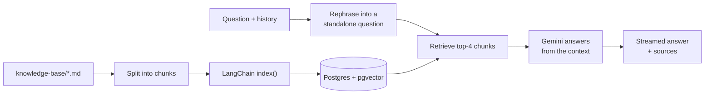

# rag-basic

A small, hands-on **Retrieval-Augmented Generation (RAG)** project: an internal company assistant that answers employees' questions using only a Markdown knowledge base and cites its sources.

Built with **TypeScript**, **LangChain.js**, **PostgreSQL + pgvector** and **Google Gemini** (through its OpenAI-compatible API).

> The knowledge base and the assistant's answers are in Ukrainian. The fictional company is called «Твоя Галера».

## Features

- **Web chat**: Express server with answers streamed token by token (Server-Sent Events), a "thinking…" indicator, numbered sources under each answer and follow-up questions that take the conversation history into account.
- **Console chat**: the same RAG pipeline in the terminal.
- **Incremental indexing**: the LangChain Indexing API with a Postgres record manager. Embeddings are computed only for new or changed chunks, and chunks of deleted documents are removed.
- **Git hooks**: the index is updated automatically when the knowledge base changes on `main`.
- **Grounded answers**: the model answers only from the retrieved context, cites `[1]`, `[2]`, … and says so when the answer isn't in the knowledge base.
- **Resilience**: model calls have a timeout and a limited number of retries, and the user sees a clear error message instead of an endless wait.
- **RAG from scratch**: an educational example with no framework and no database (embeddings, cosine similarity and top-k in plain TypeScript).

## How it works



1. **Indexing**: Markdown documents are split into chunks (500 characters, 80 overlap), embedded and stored in the `chunks` table. A record manager (`chunk_records`) remembers chunk hashes, so unchanged chunks are skipped.
2. **Retrieval**: a follow-up question is first rewritten into a standalone one using the last messages of the conversation, and then the 4 most similar chunks are found by cosine distance.
3. **Generation**: the chunks are passed to the model as numbered context, and the answer is streamed back to the client with the list of sources.

## Tech stack

| Area           | Tools                                                        |
| -------------- | ------------------------------------------------------------ |
| Language       | TypeScript (run with `tsx`), Node.js                         |
| RAG            | LangChain.js (`@langchain/core`, `openai`, `community`)      |
| Models         | Gemini chat and embedding models via OpenAI-compatible API   |
| Vector storage | PostgreSQL 17 + pgvector (Docker)                            |
| Web            | Express 5, Server-Sent Events, vanilla JS frontend           |
| Tooling        | Prettier, Git hooks                                          |

## Getting started

### Prerequisites

- Node.js 20.6+ (the scripts use `--env-file`)
- Docker
- A [Google AI Studio](https://aistudio.google.com/) API key

### Setup

```bash
# 1. Install dependencies
npm install

# 2. Create your .env from the template and set OPENAI_API_KEY (your Gemini key)
cp .env.example .env

# 3. Start Postgres with pgvector (port 5433)
docker compose up -d

# 4. Index the knowledge base
npm run index

# 5. Start the web chat at http://localhost:3000
npm start
```

Optional: enable the Git hooks that re-index the knowledge base after commits and merges on `main`:

```bash
git config core.hooksPath .githooks
```

## Scripts

| Command               | Description                                                       |
| --------------------- | ----------------------------------------------------------------- |
| `npm start`           | Web chat on `http://localhost:3000`                               |
| `npm run chat:cli`    | Console chat (indexes the working copy of the knowledge base first) |
| `npm run index`       | Incremental indexing of `knowledge-base/`                         |
| `npm run index:force` | Full re-indexing (clears the index first)                         |
| `npm run example:rag` | Educational RAG from scratch: no LangChain, no database            |
| `npm run format`      | Format the code with Prettier                                     |

## Configuration

All settings live in `.env` (see `.env.example`):

| Variable          | Description                                   | Default                  |
| ----------------- | --------------------------------------------- | ------------------------ |
| `OPENAI_API_KEY`  | Gemini API key (used via the OpenAI client)   | —                        |
| `DATABASE_URL`    | Postgres connection string                    | —                        |
| `TEXT_OUT_MODEL`  | Chat model                                    | `gemini-3.5-flash-lite`  |
| `EMBEDDING_MODEL` | Embedding model                               | `gemini-embedding-2`     |

> Changing the embedding model or the chunking settings requires a full re-index: `npm run index:force`.

## Project structure

```
├── knowledge-base/        # Markdown documents: the source of truth for the assistant
├── public/                # Web chat frontend (index.html, chat.js)
├── src/
│   ├── server.ts          # Express web chat: /api/chat with SSE streaming
│   ├── rag.ts             # Chat model, prompt and answer chain
│   ├── store.ts           # Embeddings, pgvector store, record manager
│   ├── prepare-documents.ts  # Loading and chunking documents
│   ├── index-docs.ts      # Indexing logic
│   ├── index-cli.ts       # `npm run index` entry point
│   ├── index.ts, chat.ts, ask.ts  # Console chat
│   └── examples/          # RAG from scratch (educational)
├── .githooks/             # post-commit / post-merge re-indexing on main
├── docs/                  # Project documentation and implementation plans
└── docker-compose.yml     # Postgres + pgvector
```

## Documentation

- [Indexing](docs/indexing.md): how indexing works, commands, Git hooks and known limitations (in Ukrainian).
- [Implementation plans](docs/plans/): the project was built step by step, with one plan per version (in Ukrainian).

## Adding knowledge

1. Add or edit a Markdown file in `knowledge-base/`. The first `# Heading` becomes the document title shown in the sources.
2. Run `npm run index`, or just commit to `main` if the Git hooks are enabled.
